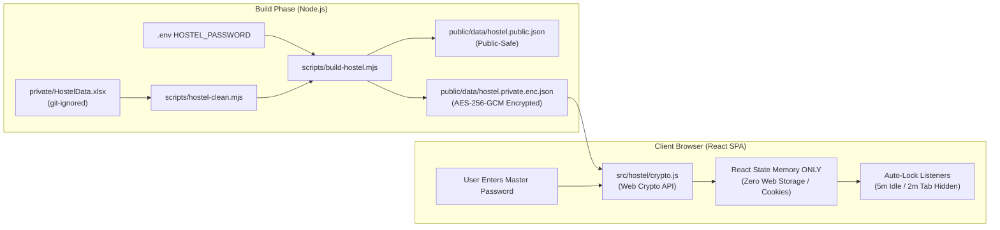

# 🧠 MPDET Predictor & Hostel Allotment 2026 — Project Context (brain.md)

> **File:** `brain.md`  
> **Repository:** `prathamdahiya42/MPDET-Webapp`  
> **Version:** v2.0.0 (Hostel Allotment + White/Pink Redesign + Encrypted Private Data)  
> **Purpose:** Single source of truth (context document) for developers, collaborators, and AI agents detailing the architecture, datasets, algorithms, components, and security model.

---

## 1. 📌 Executive Summary

**MPDET Predictor & Hostel Allotment 2026** is a single-page web application (SPA) designed for engineering candidates participating in the **Directorate of Technical Education (DTE), Madhya Pradesh** counseling and admitted to **UIT RGPV Bhopal**.

The application provides:
1. **MP DTE College Predictor**: State merit rank lookup by name or roll number, quota resolution, and personalized college/branch predictions classified into **Safe**, **Target**, and **Reach** categories.
2. **APJ Abdul Kalam Boys Hostel Allotment (Session 2026-27)**: Room numbers, roommate pairing, course/branch filters, and single-bed indicators for UIT RGPV first-year students.
3. **Official Hostel Guidelines & Checklist**: Dynamic reporting window deadline tracking, fee structure (with bus fee adjustment rules), office timings, and an interactive 9-document preparation checklist.
4. **Zero-Backend Real Encryption**: Protection of sensitive personal data (student phone numbers, father names/mobiles, and internal notes) using client-side Web Crypto API (`AES-256-GCM` + `PBKDF2-SHA256` with 600,000 iterations).

The UI is built with a mobile-first **White + Pink Design System** (Plus Jakarta Sans & Inter typography, CSS variables, and zero-JS ambient CSS blobs).

---

## 2. 🛠️ Technology Stack

| Layer | Technology | Purpose |
|---|---|---|
| **Framework** | [React](https://react.dev/) `^19.2.7` | UI component tree with Hooks (`useState`, `useEffect`, `useMemo`, `useCallback`) and React Context |
| **Build Tool & Bundler** | [Vite](https://vitejs.dev/) `^8.1.0` | Ultra-fast development server with Hot Module Replacement and production bundling |
| **Cryptography (Client)** | [Web Crypto API](https://developer.mozilla.org/en-US/docs/Web/API/Web_Crypto_API) (`window.crypto.subtle`) | Standard in-browser AES-256-GCM authenticated decryption and PBKDF2 key derivation |
| **Cryptography (Build)** | Node.js `node:crypto` | Build-time pre-encryption (`scripts/build-hostel.mjs`) executing before Vite dev/build |
| **Spreadsheet Processing** | [SheetJS (xlsx)](https://sheetjs.com/) `^0.18.5` | Server/build script parsing of `.xlsx` datasets and client-side parsing of counseling cutoffs |
| **Code Quality** | [oxlint](https://oxc.rs/) `^1.69.0` | High-speed JavaScript linter |
| **Styling** | Vanilla CSS3 + Modern CSS Tokens | Mobile-first responsive design (360px+), CSS variables, WCAG AA compliance |

---

## 3. 📂 Repository Structure

```
mpdet-app/
├── index.html                    # Entry point with <meta name="robots" content="noindex, nofollow"> & Google Fonts
├── package.json                  # Scripts (predev, dev, prebuild, build, lint), dependencies
├── package-lock.json             # Pinned dependency lockfile
├── vite.config.js                # Vite build configuration with @vitejs/plugin-react
├── .oxlintrc.json                # Oxlint rules configuration
├── .gitignore                    # Ignores private/, .env, *.cleaning-report.md, node_modules, dist
├── .env.example                  # Template environment variables (HOSTEL_PASSWORD, HOSTEL_MASK_NAMES)
├── brain.md                      # 🧠 Single source of truth context file (this document)
├── scripts/
│   ├── build-hostel.mjs          # Node build script: cleans data, derives keys, encrypts, and outputs JSON
│   └── hostel-clean.mjs          # Comprehensive dataset cleaning, transliteration, linking, and reporting
├── private/                      # [GIT-IGNORED] Owner-maintained raw datasets (never deployed)
│   ├── HostelData.xlsx           # Raw hostel allotment workbook with phone numbers & parent details
│   └── hostel.cleaning-report.md # Generated audit report itemizing every flagged row and anomaly
├── public/
│   ├── CommonView.xlsx           # MP DTE Merit List (~2.05 MB, raw student rankings & quota data)
│   ├── CLGDATA.xlsx              # MP DTE Cutoffs (~108 KB, historical college opening/closing ranks)
│   ├── favicon.svg               # Application browser tab icon
│   ├── icons.svg                 # Application SVG icons
│   └── data/
│       ├── hostel.public.json    # Public-safe hostel records (masked names, rooms, branches, AIR, meritKey)
│       └── hostel.private.enc.json # AES-256-GCM encrypted envelope of private contact details
└── src/
    ├── main.jsx                  # Root mount point wrapped in <UnlockProvider>
    ├── index.css                 # Global CSS reset, typography, and viewport background styling
    ├── theme.css                 # White + Pink color tokens, radii, shadows, and status palettes
    ├── config.js                 # App configuration & owner profile locklist (ownerLockedNames)
    ├── App.jsx                   # Main orchestrator: 3-tab segmented control, search, sticky top bar
    ├── App.css                   # Complete component styling for all 3 views, modals, cards, badges
    ├── dataLoader.js             # Merit parser, cutoff matcher, fuzzy student search, branch dictionary
    └── hostel/
        ├── crypto.js             # Browser Web Crypto AES-256-GCM / PBKDF2 decryption implementation
        ├── hostelLoader.js       # Asynchronous fetcher and in-memory cacher for public & encrypted JSON
        ├── UnlockContext.jsx     # Memory-only decryption state, auto-lock timers, attempt throttling
        ├── UnlockModal.jsx       # Accessible pink-styled focus-trapped password entry modal
        ├── HostelCard.jsx        # Integrated hostel profile card shown on student merit search
        ├── HostelTab.jsx         # Full hostel directory: room/AIR sort, course/block/branch chips, stats
        ├── hostelInfo.js         # Static notice metadata from Ref: UIT-RGPV / Chhatravas Karya / 2026 / 133
        └── HostelInfo.jsx        # Static guidance UI: deadline calculator, fee breakdown, 9-doc checklist
```

---

## 4. 🔐 Security & Encryption Architecture



### 4.1. Cryptographic Specifications
- **Cipher**: `AES-256-GCM` authenticated symmetric encryption.
- **Key Derivation**: `PBKDF2-SHA256` with **600,000 iterations**, 16-byte cryptographically random salt, generating a 256-bit key.
- **Initialization Vector (IV)**: 12-byte random IV per build.
- **Additional Authenticated Data (AAD)**: `'mpdet-hostel-v1'`.
- **Payload Shape**:
  ```json
  {
    "v": 1,
    "kdf": "PBKDF2-SHA256",
    "iter": 600000,
    "salt": "<base64>",
    "iv": "<base64>",
    "ct": "<base64-ciphertext-with-tag>",
    "aad": "mpdet-hostel-v1"
  }
  ```

### 4.2. Zero-Trace Guarantee
- **No Web Storage**: Decrypted data is held strictly in React memory state. It is never stored in `localStorage`, `sessionStorage`, `IndexedDB`, or cookies.
- **No Build Leaks**: `private/`, `.env`, and cleaning reports are git-ignored. The build fails if the password is missing or < 12 characters.
- **Robots Disallowed**: `index.html` contains `<meta name="robots" content="noindex, nofollow">`.
- **Auto-Lock Timers**:
  - Inactivity: Clears memory after 5 minutes of no user interaction.
  - Tab Hidden: Clears memory if the browser tab remains hidden (`visibilitychange`) for 2 minutes.
- **UI Rate Throttling**: 5 consecutive incorrect attempts trigger a 30-second cooldown that doubles with subsequent failures.

---

## 5. 🧹 Data Cleaning & Audit Pipeline (`scripts/hostel-clean.mjs`)

Every raw row in `private/HostelData.xlsx` is audited without deletion or merging. All anomalies are logged with their Excel row number in `private/hostel.cleaning-report.md`.

| Flag | Meaning | Cleaning Action |
|---|---|---|
| `TRANSLITERATED` | Name written in Devanagari script | Retains original Devanagari name; generates phonetic Roman `nameEn`. |
| `AIR_OUTLIER` | All India Rank > 2,000,000 | Retains parsed integer value; logs warning. |
| `INVALID_MOBILE` | Number not equal to 10 digits | Mobile set to null; raw text moved to private notes. |
| `SHARED_MOBILE` | Same phone number appears on records of students with different fathers | Logs flag; retains number in private records. |
| `NAME_TRUNCATED` | Incomplete student name (e.g. `MOHAMMAD ADNAAN AHA`) | Completed only if full surname exists in the row; otherwise kept as written. |
| `COLLEGE_OTHER` | Student college listed as "Other" | Preserved as written; tagged in public UI as "Other Institute". |
| `POSSIBLE_DUPLICATE` | Same student name + same mobile across multiple rows | Preserves both entries with unique IDs (`h001`, `h002`, ...); logs both rows. |
| `ROOM_SINGLE` | Only 1 occupant currently allotted to a double room | Roommate marked as unassigned ("Roommate not allotted yet"). |
| `ROOM_OVERFILLED` | 3 or more occupants assigned to a double room | Flagged for administrative verification. |

### Merit Linking
Students with an AIR are matched against `public/CommonView.xlsx` by normalized full name + `jeeRank == AIR`. When matched, `meritKey` is populated with the candidate's counseling roll number, allowing the College Predictor to automatically render their hostel allotment card.

---

## 6. 🎨 White + Pink Design System (`src/theme.css`, `src/App.css`)

### Color Tokens
- **Backgrounds**: `--bg #FFFFFF`, `--surface #FFF7FA`, `--pink-50 #FFF1F6`, `--pink-100 #FFE0EB`
- **Pinks / Accents**: `--pink-200 #FFC4D8`, `--pink-400 #F4709F`, `--pink-500 #EC4C8A` (primary), `--pink-600 #D6246E` (hover)
- **Typography**: `--text #2B1B24`, `--muted #7A6670`, `--border #F6D3E0`
- **Status Badges**:
  - 🟢 Safe: `#1FA971` on `#E8F8F1`
  - 🟡 Target: `#D98A00` on `#FFF6DD`
  - 🔴 Reach: `#E5484D` on `#FFECEE`

### Design Standards
- **Typography**: Google Fonts "Plus Jakarta Sans" (headings 700/800) + "Inter" (body 400/500/600).
- **Cards**: 20px border radius, 1px border, soft drop shadows (`0 8px 30px rgba(236,76,138,.12)`).
- **Touch Accessibility**: Touch targets are at least 44px high with visible 2px focus rings (`:focus-visible`).
- **Responsive Layout**: Designed mobile-first for 360px width with clean transitions to tablet and desktop. Zero horizontal scrolling.

---

## 7. 🚀 Available Scripts & Workflows

```bash
# Start development server (automatically triggers predev data build)
npm run dev

# Run data cleaner and encryptor standalone
node scripts/build-hostel.mjs

# Build production bundle (automatically triggers prebuild data build)
npm run build

# Run Oxlint code inspection
npm run lint

# Preview production build locally
npm run preview
```
